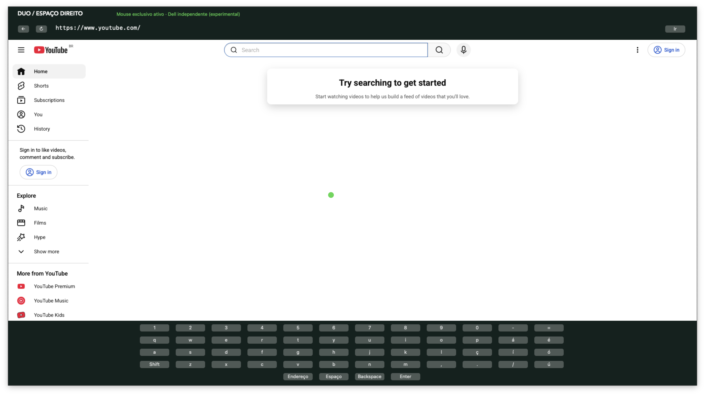

# Duo Browser

Protótipo macOS M2: navegador independente no Dell, mouse USB INSTANT
(`30fa:1040`), teclado virtual; teclado e trackpad internos continuam no macOS.
Ao abrir o app, ele abre o YouTube no Dell e tenta capturar o mouse USB automaticamente.

## Desenvolvimento com TDD

Um comando para testes automáticos Swift e JavaScript: `npm test`, sem exigir Dell ou mouse USB.
Para integração com WKWebView real no Dell, verificação de foco e captura/liberação
física do mouse: `npm run test:integration` (captura breve; libere o mouse no app antes).
Esse teste usa outro processo para confirmar que o mouse está inacessível durante
a captura e disponível novamente depois da liberação.
Build: `npm install && npm run build`. Abrir o `.app` gerado em
`src-tauri/target/release/bundle/macos/`.

A captura HID exige permissão de Monitoramento de Entrada nas configurações
de Privacidade e Segurança. Autorize Duo Browser e/ou Duo Native, conforme o nome
exibido pelo macOS, e feche/reabra o aplicativo. A permissão herdada do terminal
nos testes não garante a permissão do aplicativo aberto pelo Finder.
A captura é tentada automaticamente ao abrir o app ou reabrir o navegador; liberar
ou fechar devolve o mouse ao macOS. Teclado virtual próprio, sem usar o teclado de acessibilidade
global. Sites com eventos confiáveis, menus nativos, uploads e iframes de outra
origem podem não funcionar nesta primeira versão. Não é um multiseat completo.

Camada Tauri de controle, helper Swift para HID e painel WKWebView não ativável.
O helper não expõe comandos nativos ao conteúdo dos sites.

O script de compilação usa SDK 14.5 e um overlay temporário quando esse SDK está
instalado, para contornar duas definições de `SwiftBridging` nas Command Line Tools
deste Mac. Nos outros Macs usa o SDK selecionado pelo `xcrun` e a arquitetura do
host. `DUO_USE_SYSTEM_SDK=1` força o SDK selecionado. Não altera o SDK.

## CI e pre-commit

Requisitos: macOS 14+, Node 22.13+, Rust com `rustfmt` e `clippy`, Xcode/Command
Line Tools e `swift-format` (`brew install swift-format` se necessário).

`npm ci` instala as dependências e ativa o hook Husky de pre-commit neste repo.
Cada commit executa `npm run check`: Prettier, ESLint, formatação Swift/Rust,
Clippy com warnings tratados como erros e testes Swift/JavaScript.
O hook verifica o diretório de trabalho inteiro e não altera arquivos automaticamente.
Use `npm run format` para corrigir a formatação do Prettier; use `swift-format format -i`
e `cargo fmt --manifest-path src-tauri/Cargo.toml` para Swift e Rust.

O GitHub Actions executa o mesmo comando em macOS a cada push e pull request.
Os testes de tela e HID ficam em `npm run test:integration`, para execução local
com o Dell e mouse USB conectados e a permissão de Monitoramento de Entrada.

## Validação neste Mac

`DUO_TEST_HID=1 npm test` passou: início automático, limites do cursor, seleção
do mouse, validação de URLs, teclado virtual, WKWebView real sem mudar foco e
bloqueio do mouse para um segundo processo durante captura, com liberação e
recaptura. A versão anterior retornava sucesso na segunda abertura, mas o segundo
processo conseguia abrir o mouse: agora `IOHIDManagerOpen` usa exclusividade na
primeira abertura. No Finder, a permissão de Monitoramento de Entrada continua
sendo necessária, independentemente da permissão herdada pelos testes.

Na sessão validada, o Finder recebeu `Captura negada` pelo macOS. O mesmo app,
lançado diretamente pelo ambiente de desenvolvimento já autorizado, mostrou
`Mouse exclusivo ativo`; o processo de diagnóstico retornou
`exclusiveBlocked: true` enquanto a janela estava aberta. Para reproduzir esse
lançamento de desenvolvimento a partir deste diretório:

```bash
"src-tauri/target/release/bundle/macos/Duo Browser.app/Contents/MacOS/duo-browser"
```

Para abrir normalmente pelo Finder, conceda Monitoramento de Entrada ao Duo
nas configurações do macOS e reabra o aplicativo.

O painel permanece em nível flutuante, inclusive em outros Spaces, e consome
os eventos do cursor do macOS para não ativar o aplicativo atrás. Esses eventos
nunca controlam o cursor do Dell: só os eventos HID do mouse USB, com captura
ativa, podem clicar, mover e rolar o navegador. Liberar/negar captura desativa
essa entrada e oculta o cursor verde. A página não desenha um segundo cursor.

`npm run test:integration` verifica isolamento de eventos do trackpad antes e durante captura,
bloqueio de eventos USB depois da liberação, edição por clique HID e preservação
do foco em WKWebView real. Para dois espaços independentes, o controle deve
mostrar **Mouse exclusivo ativo**; com **Separação desativada** o mouse USB
volta a pertencer ao macOS e o navegador do Dell não recebe comandos.

## Screenshot


